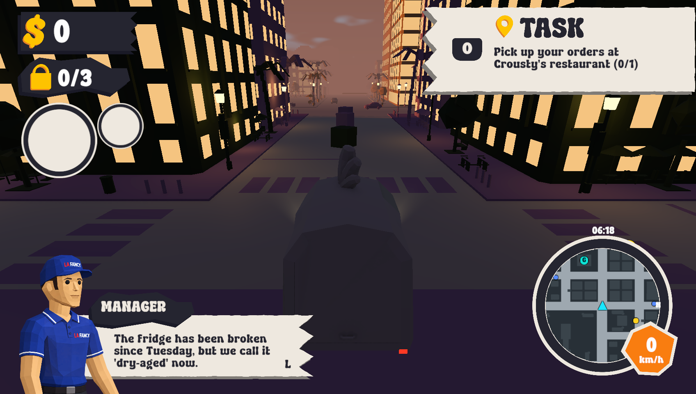
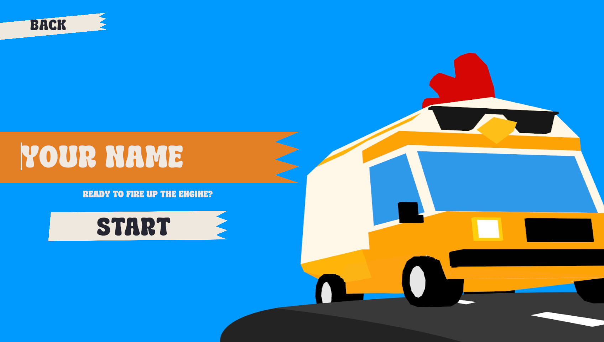

# English game text

All player-facing text is English in the title menu, name entry, credits,
leaderboard, loading panel, pause menu, results, delivery objectives, GPS,
police alerts, flight state and passenger counter. Serialized scene text and
runtime defaults were both translated. Bonus cards use their English labels.
The manager's French title image is replaced by editable `MANAGER` text using
the existing RetroBlendy font. Compact scores use an English decimal separator
(`6.8k`). Player-entered names remain unchanged.

`EnglishChecks` passed in Unity 6000.4.0f1:
`ENGLISH_CHECKS_DONE failures=0`. Checks cover all authored text in the title
and gameplay scenes, the older game scenes, the loading prefab and runtime
name prompts, leaderboard, objectives, GPS and manager title. The name-entry
screen and HUD were rendered and visually inspected. The known editor Search
indexing exception and the two historical menu texture messages are counted
separately from game errors.

## English text and credits update — 15 October 2026

Translated the remaining serialized French labels and delivery messages in SceneBaseJojo.
Bonus card labels now always use their English names. The main menu and gameplay options
contain the full team, support, special thanks, institution and asset-source credits.
Credits remain editable in the scenes and scroll with the mouse wheel, keyboard arrows,
or the controller right stick. The editor menu builder uses Resources/Crousty/Credits.txt.

This revision: C# compilation succeeded, all five edited scenes passed object-reference
checks, and the authored text audit found no remaining French in player-facing fields.
Every supplied name and source was checked against the shared credits content.
The updated credits layout has not been visually verified in Unity Play mode.
