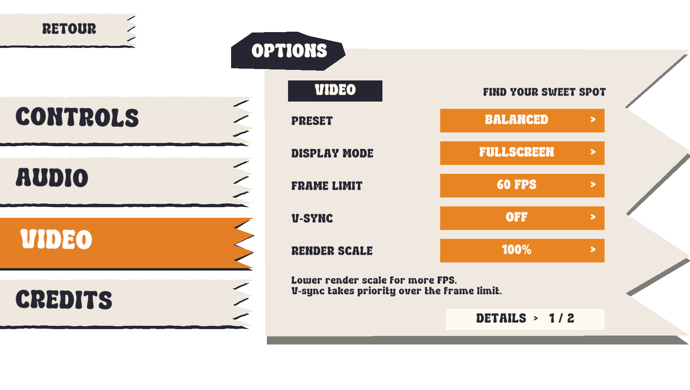
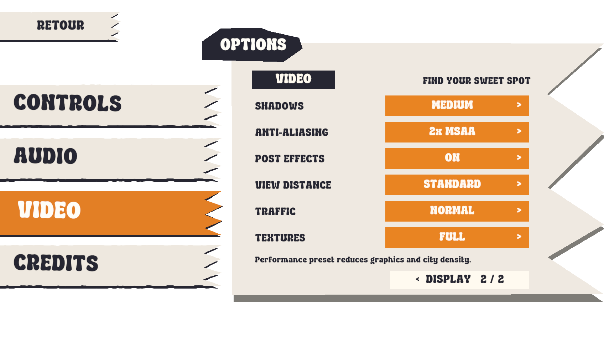

# Corrections du 14 octobre 2026

La voiture `1377 Car` utilise maintenant le matériau URP `Traffic1377`, lié
explicitement à son atlas original. Le matériau précédemment importé était gris
et n'avait aucune texture. Les autres voitures conservent leurs matériaux et
les variantes de peinture pastel.

La destruction d'une voiture civile ne déclenche plus de poursuite et n'augmente
plus l'alerte. Une patrouille doit voir le bus dépasser 50 km/h pour engager
la chasse. Détruire une voiture de police déclenche toujours la poursuite et
les renforts. Un simple contact avec une patrouille n'est plus un déclencheur.
Les attaques arrière peuvent commencer contre un bus arrêté. Après l'impact,
la police recule brièvement puis attend derrière le bus pendant la récupération
avant de pouvoir attaquer de nouveau.

Le marqueur flottant de réparation était inclus dans les maillages des trois
garages. `CroustyGarageModelImport` retire uniquement les triangles élevés du
matériau `Repair_Glow`. Les marqueurs au sol, murs, toits et portes sont conservés,
ainsi que leurs collisions dans la ville procédurale.

Les menus titre et pause contiennent des options éditables dans les scènes :

- Commandes : choix clavier/souris ou manette. Le mode clavier garde la caméra
  souris disponible même si une manette est branchée. Une manette déconnectée
  laisse le clavier disponible.
- Audio : volume général, ambiance et effets.
- Vidéo : préréglages Performance, Balanced et High ; fenêtre/plein écran ;
  limite 30, 60, 90 ou 120 FPS, ou illimitée ; V-sync ; résolution de rendu
  50, 67, 80 ou 100 % ; ombres ; MSAA ; post-traitement ; distance de la ville ;
  densité du trafic civil ; qualité des textures.

Les réglages sont sauvegardés dans PlayerPrefs. Les changements graphiques
utilisent une copie du pipeline URP créée à l'exécution. Réduire le trafic
retire progressivement les voitures civiles excédentaires. Le préchargement
respecte la distance d'affichage choisie. La ligne bleue supérieure a été retirée.
Les deux pages vidéo conservent les couleurs et les bandeaux du menu.

Après validation du nom, le volet affiche `LET'S GO!`, termine son animation,
puis reste visible pendant 0,7 seconde avant l'écran de chargement.

Validation dans une copie isolée, Unity 6000.4.0f1 :

- `ESSENTIAL_ASSET_CHECKS_DONE failures=0` : atlas original, retrait du marqueur,
  collisions des murs et toits des trois garages.
- `POLICE_CHECKS_DONE failures=0` : détection de vitesse avec visibilité,
  destruction civile sans alerte, destruction de police avec alerte, attaque
  arrière à l'arrêt, attente et nouvelle attaque après récupération,
  contacts physiques avant/arrière/côté et résistance du bus.
- `ESSENTIAL_OPTIONS_CHECKS_DONE failures=0` : valeurs réellement appliquées
  dans URP, limite FPS, boutons, mode d'entrée, tailles des sélecteurs et
  captures vérifiées en 1696×960, 1280×960 et 2520×1080.
- `NAME_ENTRY_CHECKS_DONE failures=0` : saisie, retour, nom enregistré,
  animation terminée avant le chargement et ouverture réelle de SceneBase.

Un composant de commandes HUD incomplet copié sur une carte bonus était
également actif dans la scène. Ce doublon est désactivé ; la carte reste présente
et le composant complet conserve les commandes partagées du HUD.

L'erreur d'indexation `UnityEditor.Search` concerne l'éditeur et est distinguée
des erreurs du jeu dans les contrôles. Les deux messages historiques
`No texture data is available to upload.` du menu restent comptabilisés à part
dans `NameEntryChecks`. Aucun nouveau message d'erreur du jeu pendant les tests.

